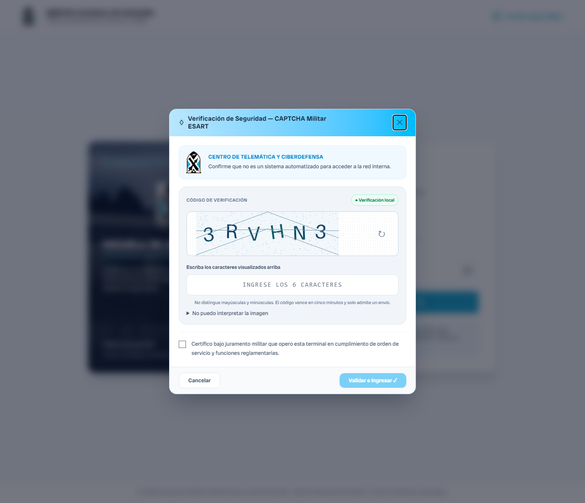

# CAPTCHA: diagnóstico real y ejecución controlada de p0004

Fecha: 16 de noviembre de 2026, Colombia.

## Resultado posterior al COMMIT comunicado por el operador

El operador ejecutó `herramientas.aplicar_captcha_local --aplicar`, confirmó COMMIT y verificó directamente `esart.alembic_version = p0004_captcha_local`. Esta sesión no concedió permisos adicionales para leer esa tabla: la revisión se atribuye a la comprobación administrativa comunicada, mientras que los objetos y permisos siguientes sí fueron consultados directamente con esart_aplicacion.

### Verificación directa sobre esart_db

- Tabla `esart.desafios_captcha` presente: ID VARCHAR(43), contexto y respuesta_hmac VARCHAR(64), tres TIMESTAMPTZ; solo consumido_en admite NULL. PK, CHECK de plazo y consumo e índice de expiración presentes.
- Auditoría conserva la FK de intentos, añade `fk_auditoria_captcha` y CHECK que exige intento, desafío u origen. No se modificaron filas históricas durante esta validación.
- Permisos efectivos: SELECT=true, INSERT=true, UPDATE(consumido_en)=true; UPDATE general=false y DELETE=false.
- Desafíos con duración exacta de **300 segundos**, HMAC de longitud 64 y sin respuesta en texto plano.
- Se consumieron únicamente desafíos nuevos de diagnóstico autorizados. No se llamó al login ni se hicieron intentos fallidos, cambios de usuarios o bloqueos reales.

### Angular y FastAPI en Chrome real

La misma petición que antes devolvía 503 pasó a **200** sin cambiar el contrato ni introducir una imagen de respaldo. Chrome recibió el PNG del backend a través de `http://127.0.0.1:4200/api/auth/captcha`, con X-ESART-Usuario correcto. Se comprobó `Cache-Control: no-store`, longitud=6 y ausencia de campo de solución.

El elemento real del modal completó la carga con naturalWidth=312 y naturalHeight=96; el mensaje de error quedó vacío. La inspección visual confirmó los seis caracteres generados localmente y el diseño institucional conservado. No fue necesario modificar Angular: el bloqueo estaba en la estructura ausente, corregida por p0004.



Regenerar desde el botón real envió X-ESART-Captcha-Anterior, obtuvo otro ID y marcó consumido_en del desafío previo. Se comprobó en PostgreSQL que el nuevo todavía no estaba consumido.

Para verificar el proveedor sin provocar un login fallido se generaron dos desafíos adicionales mediante el servicio real, con nombres de diagnóstico independientes de las cuentas. Solo el proceso de prueba capturó transitoriamente la salida del generador aleatorio real para responder correctamente; no se cambió el proceso FastAPI ni se publicaron o persistieron soluciones.

| Caso | Resultado |
| --- | --- |
| Respuesta correcta en minúsculas | Aceptada |
| Segunda validación del mismo desafío | Rechazada |
| Respuesta incorrecta en desafío nuevo | Rechazada y consumida |
| Respuesta correcta posterior al fallo | Rechazada por consumo previo |

### Pruebas y límites

- Backend: **178 aprobadas, 36 omitidas**; Ruff sin errores.
- Angular: **43 aprobadas**, ocho archivos; build de producción correcto.
- Pruebas nuevas de expiración: aceptación un microsegundo antes del vencimiento, rechazo al llegar exactamente a cinco minutos y después; todos los casos consumen y auditan. Se controla el reloj solo en la prueba unitaria, sin alterar fechas de PostgreSQL ni esperar cinco minutos en una cuenta real.
- Las reglas 3/7/3h permanecen intactas y sus pruebas unitarias pasan; no se reprodujo un bloqueo sobre cuentas operativas. Las pruebas PostgreSQL aisladas previas de umbrales se documentan en HU_CAPTCHA_LOCAL.md; no son nuevas ejecuciones.
- No se ejecutaron nuevas migraciones. No se intentó autenticación con credenciales de una cuenta real: la comprobación de respuesta se hizo con el proveedor que usa el login.

Evidencia adicional en `backend/respaldos/captcha_navegador/`: `exito.json`, `regeneracion_exito.json`, `persistencia.json`, `consumo_real.json`, `estructura_final.json`, `modal_real.png` y `endpoint_real.png`. No contienen contraseñas ni tokens JWT; no se registraron soluciones en los JSON.

Archivos de esta continuación: este informe, avisos de actualización en `HU_CAPTCHA_LOCAL.md` y `ESART_CAPTCHA_422.md`, `docs/imagenes/captcha_integrado.png` y la prueba nueva `backend/pruebas/test_captcha_vigencia.py`. No hubo cambios de código Angular, migraciones ni configuración operativa.

## Registro anterior: ejecución administrativa entonces pendiente

Se recibió autorización expresa para p0004 exclusivamente en esart_db y para desafíos de prueba, sin intentos fallidos de login. Esta sesión no dispone de una conexión administrativa utilizable: ESART_MIGRACIONES_URL no está configurada; la autenticación local de postgres sin contraseña fue rechazada. No se solicitó ni registró ninguna contraseña. No se sustituyó la conexión de FastAPI.

## Causa exacta observada

- FastAPI activo: GET `/api/auth/captcha` **con** X-ESART-Usuario devolvió **503**, código `CAPTCHA_NO_DISPONIBLE` y mensaje «Verificación temporalmente no disponible».
- Inspección PostgreSQL de solo lectura con `esart_aplicacion`: base `esart_db`; no existe `esart.desafios_captcha`; `esart.auditoria_acceso` contiene únicamente id, intento_id, evento y fecha. El guard de estructura del servicio produce ese 503 antes de generar imágenes o insertar desafíos.
- `esart.alembic_version` existe, pero la aplicación no tiene SELECT sobre ella. No se ha afirmado que p0003 esté comprobada directamente: el operador debe comprobar su valor antes de aplicar p0004.
- La aplicación tiene SELECT/INSERT sobre auditoría y límites IP. No se puede conceder ni comprobar acceso a una tabla CAPTCHA todavía inexistente. p0004 concede SELECT/INSERT y UPDATE(consumido_en), sin UPDATE general ni DELETE.

El 422 anterior era otra condición: falta de cabecera obligatoria. No explica la petición actual, donde la cabecera sí llega.

## Comprobación en navegador real

Se inició Angular con su proxy real y Chrome headless con perfil separado, sin interceptar ni sustituir respuestas HTTP. En el build de desarrollo se abrió el modal mediante la API de inspección Angular, usando `diagnostico.captcha` como contexto. No se enviaron credenciales ni se provocaron fallos de login para abrirlo.

Chrome observó:

| Comprobación | Resultado |
| --- | --- |
| Nombre recibido por componente | diagnostico.captcha |
| URL de generación | http://127.0.0.1:4200/api/auth/captcha |
| Cabecera X-ESART-Usuario | diagnostico.captcha |
| Respuesta a través del proxy | 503 CAPTCHA_NO_DISPONIBLE |
| Estado del modal | sin PNG, muestra el mensaje del servidor |
| Botón regenerar | emite otra solicitud con cabecera; vuelve a recibir 503 |
| PNG local de prueba con Pillow | Chrome lo decodifica correctamente, 312×96 |

El PNG de prueba no fue insertado como respuesta falsa del endpoint ni como imagen de éxito del modal. Se verificó aisladamente la decodificación `data:image/png;base64,...`. No se declara todavía que el modal operativo muestre un desafío.

Evidencia local excluida de Git: `backend/respaldos/captcha_navegador/diagnostico.json`, `regeneracion_http.json`, `error503.png` y `muestra_local.png`.

## Respaldo y compatibilidad

El archivo `D:\2026\esart\respaldos\esart_db_pre_hu04.backup` existe (147987 bytes). Se recalculó SHA-256: `4d6ecc85006e37b16e92d6fdc0cafd577384fc842e49b6efcd3cd03e0f99dfcb`, igual al archivo cuya restauración aislada fue validada anteriormente; véanse `ESART_RESPALDO_VERIFICACION.json` y `ESART_DESPLIEGUE_BASE_PRINCIPAL.md`. No es un nuevo respaldo del estado actual de usuarios: no se presenta como tal.

p0004 crea desafíos, índice y checks, añade dos columnas y una FK a auditoría, permite intento_id nulo para eventos de generación y exige una referencia de auditoría. No contiene DML sobre usuarios, contraseñas, roles, permisos o auditoría histórica. No contiene DROP, TRUNCATE ni revocaciones. Los permisos nuevos se limitan a la tabla CAPTCHA. Las revisiones anteriores no se modifican.

## Comando para terminal administrativa local

Desde `D:\2026\esart\esart\esart\backend`:

```powershell
.venv\Scripts\python.exe -m herramientas.aplicar_captcha_local --aplicar
```

La contraseña de postgres se solicita con getpass, sin eco y sin archivo. Para otra cuenta administrativa autorizada: `--operador <nombre>`. No enviar la contraseña por el chat. Sin `--aplicar` se ejecutan solo precondiciones de lectura.

El comando:

1. Comprueba huella del respaldo validado y lectura de su catálogo con pg_restore.
2. Conserva host, puerto y base de la configuración operativa; exige esart_db y una cuenta administrativa distinta de esart_aplicacion.
3. Exige exactamente p0003_control_intentos y estructura de auditoría compatible. Se detiene ante divergencias; no usa stamp ni aplica revisiones intermedias para ocultarlas.
4. Ejecuta Alembic hasta p0004 dentro de la conexión y transacción verificadas, con límites de espera.
5. Comprueba revisión final, conteo histórico de auditoría y permisos mínimos. Si falla, revierte. No toca usuarios ni dispara solicitudes de login.
6. Solo anuncia COMMIT después de confirmar la transacción. No publica mensajes del controlador que puedan contener secretos.

Después del COMMIT quedan por ejecutar contra el servidor real: generación en modal, visualización de seis caracteres, regeneración y comprobación de consumo/vencimiento mediante desafíos autorizados, sin intentos fallidos sobre cuentas reales. No se declarará cerrado hasta verificarlo.

## Pruebas de código en esta revisión

Backend: **175 aprobadas y 36 omitidas** (integraciones no habilitadas); Ruff sin errores. Las pruebas nuevas detienen el operador ante un respaldo diferente del restaurado o ilegible para pg_restore. La validación PostgreSQL real previa de p0004 está documentada en `HU_CAPTCHA_LOCAL.md`; no sustituye la comprobación pendiente del destino operativo.
