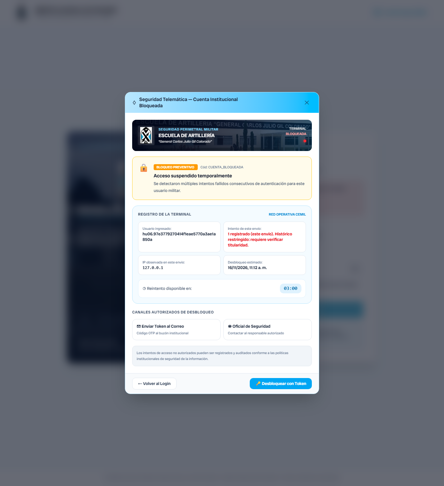

# Corrección del flujo público del Registro de la terminal

## Causa corregida

Las revisiones previas completaban la lectura administrativa, pero el login público continuaba usando un contrato de estado temporal que excluía cualquier detalle del intento. Por ello el modal de ese flujo seguía mostrando valores restringidos. Tener datos en PostgreSQL no hacía que esa consulta los autorizara.

Ahora se implementó la alternativa segura solicitada: **presentar datos del envío que acaba de realizar el navegador, sin revelar el contador histórico ni IP de otros intentos**. No se utilizó una sesión administrativa para habilitar el modal público.

## Qué muestra el modal público

| Campo | Valor y procedencia |
| --- | --- |
| Usuario ingresado | Nombre enviado en ese flujo, normalizado por el backend; no acredita titularidad |
| Intento de este envío | **1 registro de ese envío**, asociado al IntentoInicioSesion insertado y confirmado; no es el total consecutivo de la cuenta |
| Histórico | Restringido hasta verificar titularidad; nunca se infiere siete del umbral ni se copia el contador de otra cuenta |
| IP observada en este envío | Dirección que el backend asignó al registro del POST actual; si no es verificable, se informa así |
| Desbloqueo | Fecha bloqueado_hasta del estado persistente, como en la política existente |
| Reintento disponible | HH:MM derivado de la fecha y hora de servidor, con un único reloj de presentación |

El registro de un envío rechazado durante un bloqueo vigente **no implica otro incremento del contador consecutivo** ni extiende el bloqueo. El dato público es la existencia de ese registro de solicitud, no una autorización para consultar el historial de la cuenta.

El texto y la etiqueta distinguen explícitamente “este envío” de “histórico”. Una dirección loopback se describe como origen de conexión observado por el backend, posiblemente local o de proxy, no como IP pública de una terminal remota. No se comenzó a confiar en X-Forwarded-For.

## Recorrido de los datos

1. **POST /api/auth/login**: la lógica central registra el intento, conserva la referencia al registro recién insertado y construye `detalle.intento_actual` solamente para ese envío. La respuesta 423 se entrega después de confirmar intento, contador y auditoría. Si la transacción falla, no se entrega una instantánea de éxito ficticio.
2. La misma respuesta mantiene `intentos_fallidos_consecutivos: null`, `direccion_ip: null` y `detalles_autorizados: false`: esos campos se refieren a información histórica de cuenta. No se habilitan por recibir un comprobante.
3. El controlador firma la instantánea permitida dentro de la cookie HttpOnly de contexto ya existente. Incluye alcance ENVIO_ACTUAL, fecha, cardinalidad del registro del envío y dirección observada. No incluye ID de cuenta, contraseña, hash ni contador acumulado. La cookie no es sesión de autenticación.
4. **GET /api/auth/bloqueo**: verifica firma, audiencia y expiración, lee el estado temporal de PostgreSQL para el contexto firmado y recupera la misma instantánea del comprobante. No busca la IP del último intento de la cuenta y no sustituye la IP por la del GET de recarga.
5. Angular valida alcance, número de registros y fecha de la instantánea; usa ese dato en el modal independientemente del indicador que restringe información histórica. Mantiene el contador de seguridad exclusivamente en FastAPI/PostgreSQL.

Fragmento del contrato público nuevo:

```json
{
  "detalles_autorizados": false,
  "intentos_fallidos_consecutivos": null,
  "direccion_ip": null,
  "intento_actual": {
    "alcance": "ENVIO_ACTUAL",
    "envios_registrados": 1,
    "fecha": "<fecha del registro del POST>",
    "direccion_ip_observada": "<origen observado o null>",
    "observacion_ip": "<explicación del alcance del origen>"
  }
}
```

La cardinalidad uno corresponde al único registro de ese POST que acaba de confirmarse; no se usa como sustituto del contador acumulado. El cliente no puede enviar intento_actual: el esquema rechaza ese campo con 422. Tampoco puede cambiar el contexto usando nombre_usuario en la URL o X-ESART-Usuario al consultar el estado.

## Seguridad y compatibilidad

El comprobante por sí solo sigue sin demostrar quién es el propietario. Por eso no devuelve IP histórica ni contador acumulado: solo conserva lo que corresponde al envío que obtuvo ese comprobante. Un navegador nuevo que intente un nombre ya bloqueado recibe, como máximo, los datos de su propio envío rechazado.

Sin comprobante válido no se realiza una consulta arbitraria de la cuenta. Cambiar parámetros con una cookie válida no cambia el contexto firmado. Alterar el token invalida su firma. No se agregaron endpoints públicos por ID de usuario ni se relajaron permisos administrativos.

Los comprobantes emitidos antes de esta revisión **no contienen instantánea**. No puede reconstruirse retroactivamente la autoría de un intento con ellos. El modal explica que ese comprobante no incluye datos del envío, en lugar de inventarlos o consultar el histórico. Los envíos posteriores con la versión nueva reciben la instantánea; no se forzaron intentos sobre usuarios reales para actualizar cookies antiguas. Tras desplegar, backend y frontend deben usar esta versión para emitir y consumir el nuevo contrato.

La recuperación del estado sigue siendo de lectura; no reinicia ni prorroga un bloqueo. Los errores de infraestructura y regeneraciones no suman fallos. Se conservan CAPTCHA desde el cuarto intento, bloqueo de tres horas al séptimo y cuotas IP. El único cambio de clave de la prueba se aplica a su despliegue aislado efímero, para separar sus cuotas de otros casos, sin elevar límites ni rotar claves del entorno operativo.

## Prueba real completa, sin sesión administrativa ni datos simulados

Se ejecutó `test_flujo_publico_completo_chrome_sin_sesion` con:

- Una cuenta generada únicamente en un clúster PostgreSQL nuevo, con directorio marcado y puerto diferente del operativo.
- FastAPI/Uvicorn real con la conexión de aplicación de ese clúster.
- Angular real servido en otro puerto, usando un proxy temporal a ese FastAPI.
- Chrome headless con perfil separado, dirigido mediante DOM/CDP.

El script solo escribe campos y pulsa botones. **No intercepta HTTP, no sustituye respuestas, no llama métodos privados de Angular, no inyecta estado y no usa un JWT administrativo.** Las capturas provienen de las respuestas reales del flujo público a través del proxy y de los registros reales de esa cuenta aislada.

Resultados observados:

1. Primeros tres envíos: 401; no se solicita imagen CAPTCHA antes del cuarto.
2. Envíos cuarto a séptimo: cuatro imágenes PNG generadas realmente por el servidor. Se introducen deliberadamente caracteres no válidos para el alfabeto del CAPTCHA, sin resolver ni simular validación exitosa.
3. Estados de login: **401, 401, 401, 401, 401, 401, 423**.
4. Séptimo envío: plazo exacto **10800 segundos**; PostgreSQL registra contador siete, fecha correspondiente y exactamente siete intentos para esa cuenta.
5. El modal muestra el nombre ingresado, **1 registro de este envío**, IP observada, histórico restringido y plazo real. No existe cookie esart_sesion.
6. Recarga real del navegador: GET recupera la misma instantánea y bloqueado_hasta; no se realiza otro POST y PostgreSQL mantiene siete intentos.
7. Parámetro/cabecera de otra cuenta: no cambian el contexto ni revelan contador/IP históricos. Al borrar la cookie, una consulta por nombre no devuelve instantánea ni detalles.

### Capturas del flujo público

Después del bloqueo:



Después de recargar la página:


Los nombres mostrados son aleatorios de prueba. No se modificó prueba.seguridad ni admin.esart ni se cambiaron contraseñas reales. No se aplicaron migraciones ni escrituras a la instancia operativa. Las migraciones existentes solo preparan el clúster aislado; no se modificaron sus archivos.

Evidencia: `backend/respaldos/hu06_c9c575286e974e979c354e9e9bcb7dba/navegador_publico/resultado.json`, junto a capturas y logs de los servicios aislados. El clúster, Chrome y los procesos temporales se detuvieron al finalizar. No se guardaron cookies, tokens o contraseñas en el JSON de evidencia.

## Archivos y validación

- Backend: `servicios/seguridad_login.py`, `seguridad/comprobante_bloqueo.py`, `rutas/autenticacion.py`.
- Frontend: modelos `sesion.ts`; `inicio-sesion.ts`, `inicio-sesion.html`; `ventana-bloqueo.ts`, `ventana-bloqueo.html` y pruebas correspondientes. No cambia el CSS institucional.
- Automatización reproducible: `herramientas/probar_flujo_publico_navegador.py`, `herramientas/navegador_publico.mjs`, caso público en `pruebas/test_captcha_local_pg.py`. El ejecutor existente ahora tolera diferencias de codificación en logs Windows.
- Seguridad: prueba que rechaza la inyección de una instantánea en el cuerpo de login y las pruebas previas de firma, contexto y acceso privado.
- Este informe y capturas públicas.

Verificación: **184 pruebas backend aprobadas, 42 omitidas** al no habilitar integración en ese comando; **29 pruebas PostgreSQL aisladas aprobadas, incluida Chrome**, además de compatibilidad HTTP con p0003. **52 pruebas Angular aprobadas**, build de producción correcto y Ruff sin errores. Se conservó el proxy operativo y el archivo .env.
