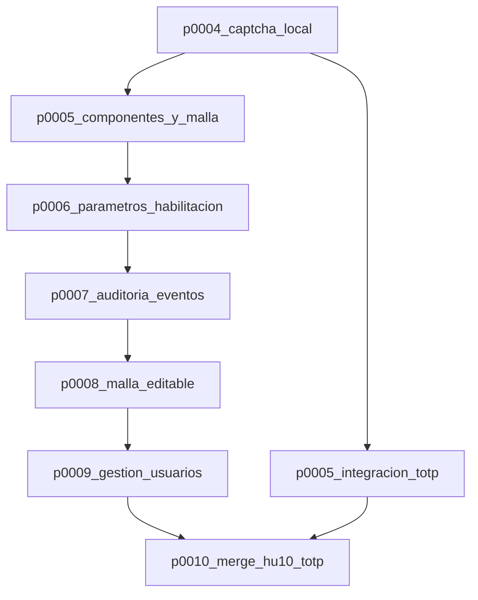

# Resolución de conflictos HU-08/HU-09/HU-10 y seguridad local

## Resultado y alcance

Se combinaron manualmente los siete conflictos originados por origin/desarrollo y stash apply. No se seleccionó íntegramente una versión upstream/local para reemplazar sus funcionalidades. Se conservaron los routers, gestión de usuarios, malla, auditoría y verificación remotos, junto con CAPTCHA, bloqueo, QR/TOTP y recuperación locales.

HEAD de partida: 8b0829d. Stash preservado: c24e35abb64dcf131d5c5a15bf4faa3bdd50050f. No se ejecutaron reset --hard, clean, stash pop/drop, commit, push, stamp ni migraciones. La escritura del índice se limitó a los siete archivos en conflicto; los cambios complementarios permanecen en el árbol de trabajo para revisión.

## Conflictos resueltos

| Archivo | Resolución |
|---|---|
| backend/aplicacion/principal.py | Se registran administración, verificación, autenticación, catálogos, TOTP y acciones seguras. Se conserva no-store en autenticación/seguridad y los alias /api/v1 existentes. |
| backend/aplicacion/rutas/autenticacion.py | Conserva CAPTCHA, comprobante persistente de bloqueo, consulta administrativa, cambio de contraseña y auditoría HU-11. Un desafío 202 no genera LOGIN_EXITOSO ni cookies de sesión. |
| backend/pruebas/test_persistencia_principal.py | Conserva las revisiones remotas y verifica la unión de las dos ramas, sin sustituir HU-10 por la cabeza TOTP. |
| frontend/esart/src/app/app.routes.ts | Conserva Plataforma, dashboard, usuarios, personal/verificación/habilitados, malla, auditoría, cambio obligatorio y guardas. Añade /totp protegida por sesión, sin restaurar /inicio. |
| frontend/esart/src/app/nucleo/servicios/sesion.service.ts | Combina menú/permisos y renovación remotos con CAPTCHA/MFA locales y el desafío de cambio inicial sin JWT. Limpia menú/permisos anteriores al comenzar otra autenticación. |
| frontend/esart/src/app/paginas/inicio/inicio.html | Se acepta su eliminación upstream después de trasladar el acceso al autenticador al panel vigente. |
| frontend/esart/src/app/paginas/inicio/inicio.ts | Se acepta su eliminación upstream; el cierre de sesión permanece en Plataforma. No se restaura el componente provisional. |

El componente vigente es paginas/panel-principal/panel-principal.ts, con plantilla inline. El acceso CONFIGURAR AUTENTICADOR se integró allí conservando los accesos filtrados por permisos. TOTP utiliza las constantes de navegación vigentes y el recorrido de navegador espera /dashboard.

## Flujo conjunto de autenticación

1. Contraseña, estado activo y roles se comprueban con el servicio existente. CAPTCHA y los presupuestos/bloqueo persistentes se mantienen antes del siguiente paso.
2. Cuando requiere_cambio_contrasena=true, el backend entrega un desafío CAMBIO_CONTRASENA, limitado, ligado al navegador y con expiración. No crea sesión ni JWT. Angular abre el componente CambiarContrasena existente mediante una guarda que acepta únicamente ese contexto restringido.
3. POST /api/auth/cambiar-contrasena-inicial comprueba el propósito, nonce HttpOnly, expiración, intentos, cuenta no bloqueada y contraseña actual. Reutiliza las reglas HU-10: contraseña nueva válida y distinta, hash bcrypt, quitar marca temporal y revocar sesiones anteriores. No acepta usuario_id del cliente.
4. El cambio, auditoría, consumo del desafío anterior y creación del siguiente se confirman juntos. Los desafíos previos pendientes se cancelan. La respuesta sigue siendo 202, ahora VINCULACION o LOGIN según el factor; todavía no hay JWT ni acceso al dashboard.
5. Si falta factor activo, Totp abre CONFIGURAR y pide la URI/QR al backend. La cuenta se obtiene del desafío, sin JWT provisional de acceso completo. La activación solo ocurre tras validar un código real de seis dígitos.
6. Si ya hay factor, Totp abre LOGIN sin revelar el QR/secreto. El desafío y el código/recuperación se validan como antes, con propósito y límites separados de contraseña.
7. finalizar_login vuelve a revisar rol, estado y ausencia de contraseña temporal. Rechaza emitir JWT si aún se exige cambio, aunque se haya verificado TOTP. Crea sesión y conserva auditoría local y LOGIN_EXITOSO HU-11 en el mismo commit. Las cookies definitivas se escriben solo después del éxito.
8. /yo conserva menú, permisos y renovación por actividad; las guardas y permisos backend siguen protegiendo los módulos HU-08/HU-09/HU-10. CambiarContrasena también conserva su uso voluntario dentro de una sesión ya autenticada.

El desafío de cambio inicial usa LOGIN_TOTP y las columnas existentes de seguridad.desafios; no introduce una tabla, columna ni política nueva. Cerrar/recargar antes de completar los pasos no concede sesión. Al perder el estado Angular se requiere autenticar de nuevo. Los errores de primer acceso no se convierten falsamente en expiración de una sesión completa.

## Funcionalidades conservadas

- HU-10: gestión web/consola de usuarios, asociación militar/cédula, contraseña temporal, cambio obligatorio, restablecimiento, activación/desactivación y administración de roles/permisos.
- HU-08/HU-09/HU-11: Plataforma y menú por permisos, verificación/habilitación, consultas y auditoría. Se mantienen los routers y componentes remotos; no se sustituyen por el inicio provisional.
- Local: diseño del CAPTCHA sin cambios en esta integración, contador de contraseña separado de CAPTCHA/TOTP, siete fallos comprobados, tres horas, HTTP 423, VentanaBloqueo y persistencia del comprobante.
- Local: cifrado TOTP, QR solo de vinculación, verificación de seis dígitos, nonce ligado al navegador/propósito, consumo y prevención de reutilización, recuperación y revocación. Desbloquear con TOTP sigue sin iniciar sesión automáticamente.

## Archivos complementarios

Además de los siete conflictos, se ajustaron:

- Backend: servicios/autenticacion.py, administracion_usuarios.py y auditoria.py; servicios/totp.py y rutas/totp.py. La auditoría admite confirmar=False para incorporarse a la transacción de autenticación; su comportamiento predeterminado de confirmar se conserva para el resto de HU-10.
- Angular: panel-principal.ts, guardas/sesion.guard.ts, modelos/sesion.ts, interceptor de sesión, inicio-sesion.ts, cambiar-contrasena.ts y totp.ts.
- Pruebas: test_integracion_hu10_mfa.py nuevo, test_totp_unidad.py y sesion.service.spec.ts. Se corrigieron dobles de prueba de add(), que es síncrono en SQLAlchemy, en test_permisos_hu03.py y test_comprobante_bloqueo.py.
- Herramienta navegador: destino /dashboard actualizado. La prueba interactiva anterior quedó interrumpida al cambiar la tarea y no se presenta como evidencia de este merge.
- .gitignore excluye el ejecutable Epson_L3210_Series_EM_50_Web.exe; los archivos .env y respaldos siguen excluidos. No se agregó el ejecutable ni se eliminaron archivos personales.

## Alembic: ramas y propuesta válida

No hay dos revisiones con el mismo identificador. La coincidencia p0005 en los nombres de archivo no es una colisión de revision: p0005_componentes_y_malla y p0005_integracion_totp son identificadores distintos que descienden de p0004_captcha_local, creando dos cabezas antes de esta corrección.

Se añadió p0010_merge_hu10_totp.py, con down_revision=(p0009_gestion_usuarios, p0005_integracion_totp). upgrade/downgrade están vacíos: unen el grafo y no alteran estructura. No se cambiaron revision ni down_revision de ninguna revisión existente. `alembic heads` identifica una única cabeza p0010_merge_hu10_totp.

**Historial aplicado no confirmado:** la consulta de solo lectura encontró que esart_aplicacion no tiene SELECT sobre esart.alembic_version. No se concedieron permisos para sortearlo. Se verificó la presencia de requiere_cambio_contrasena, pero eso no acredita que toda p0009 esté aplicada ni autoriza a repetir revisiones. El operador debe consultar la versión real con su conexión autorizada antes de cualquier actualización.

Antes de actualizar PostgreSQL:

1. Obtener respaldo restaurable y consultar esart.alembic_version como propietario, sin stamp.
2. Comparar cada revisión pendiente con los objetos reales; no inferir el historial a partir de una sola columna existente.
3. Revisar p0005_integracion_totp: incluye FK, triggers y grants para operaciones sensibles. La aplicación manual de permisos mínimos/políticas no equivale a haber aplicado esa revisión. Sus privilegios sobre autorizaciones requieren autorización específica; el merge no los concede ni los necesita para el login.
4. Revisar p0005_componentes_y_malla a p0009, incluidos permisos de usuarios, auditoría y malla, para evitar recrear objetos ya existentes o perder asociaciones.
5. Aprobar el plan de actualización de ambas ramas y su unión antes de ejecutar cualquier upgrade. La revisión de merge vacía no convierte en inocuas las revisiones pendientes de sus ramas.

## Validación y límites

- Backend: 259 pruebas aprobadas, 100 omitidas y seis subtests aprobados. Se verifican los routers HU-10 y locales, controles CRUD/auditoría, el primer paso sin sesión, cambio temporal seguido de MFA, no emisión de JWT con contraseña temporal y auditoría conjunta al finalizar MFA.
- Angular: 104 pruebas aprobadas en 18 archivos. Compilación de producción aprobada. Se mantienen los avisos de presupuesto CSS TOTP y dependencia CommonJS qrcode.
- Grafo Alembic: una cabeza, sin ejecutar upgrade ni conectar para cambios de esquema.
- Los marcadores de conflicto se buscan como líneas completas; los separadores decorativos de comentarios existentes no son conflictos.
- Estado final de Git: `git ls-files -u` y `git diff --name-only --diff-filter=U` vacíos; sin UU/DU pendientes. HEAD y stash mantienen los identificadores del inicio. `git diff --check` y su variante --cached sin errores. Se revisaron los 28 archivos indexados modificados para comprobar que no contengan los secretos configurados, sin imprimirlos; no hubo coincidencias. Epson y backend/.env están ignorados y el ejecutable no está en el índice.
- La validación PostgreSQL completa del flujo integrado y del historial desplegado sigue pendiente de un entorno autorizado con revisiones/permisos confirmados. Las pruebas omitidas no se presentan como aprobadas ni los resultados anteriores de navegador como pruebas del merge actual.

El árbol conserva cambios locales y archivos nuevos de seguridad que ya existían antes de esta tarea. Resolver conflictos no equivale a preparar automáticamente todos esos archivos para un commit: revisar `git diff`, `git diff --cached` y los archivos nuevos antes de decidir qué incorporar. El stash permanece disponible como respaldo.
