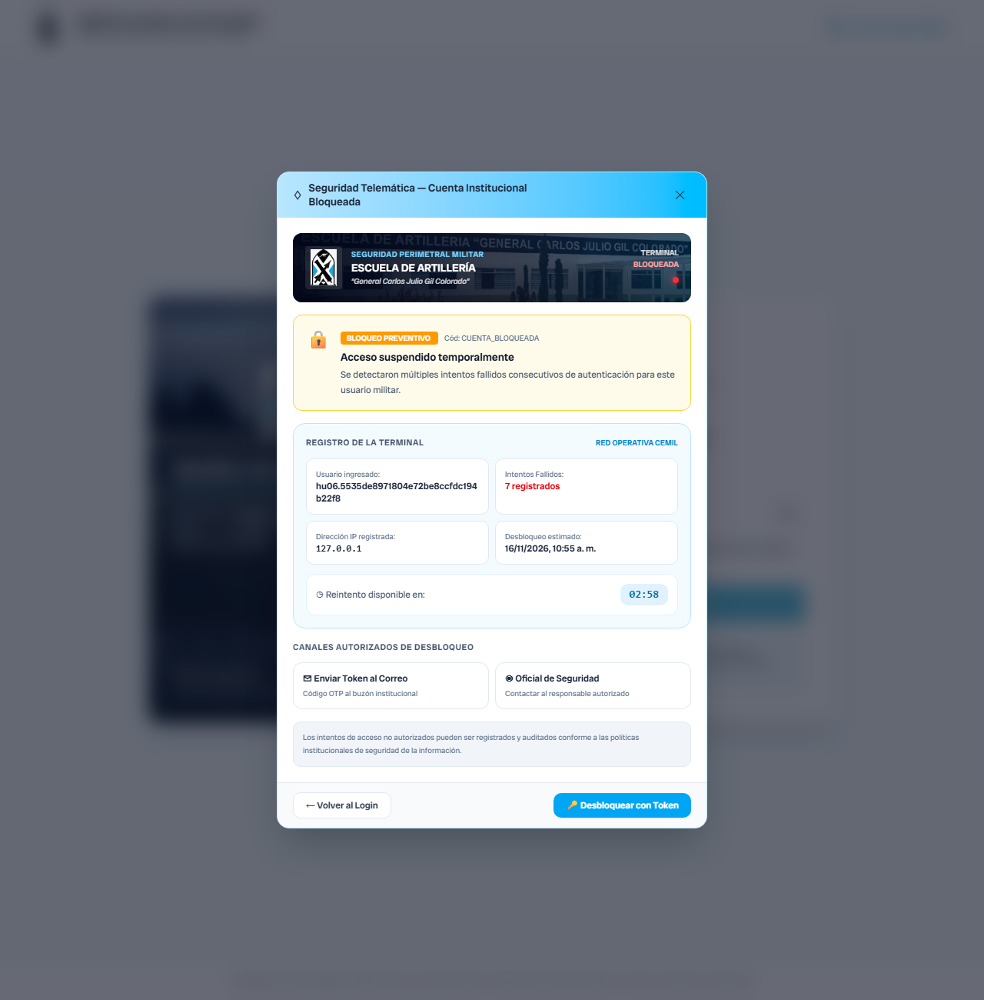

> Flujo publico actualizado: [registro del envio actual y prueba completa en Chrome](ESART_FLUJO_PUBLICO_REGISTRO_TERMINAL.md). Ahora el modal publico presenta la instantanea de su propio POST y la conserva al recargar; el historico sigue restringido. Esta revision anterior describe el estado previo.

# Registro de la terminal: IP registrada y validación con datos reales autorizados

## Causa y límite de autorización

Los textos se renderizan en `frontend/esart/src/app/paginas/inicio-sesion/ventana-bloqueo/ventana-bloqueo.html`. Ya no son ceros ficticios: aparecen cuando el contrato no autoriza detalles o no proporciona una IP.

- POST `/api/auth/login` con 423 y GET `/api/auth/bloqueo` mantienen `detalles_autorizados: false`, contador e IP null. El comprobante solo conserva contexto; cualquier navegador puede obtener uno al intentar un nombre ya bloqueado. No acredita titularidad de la cuenta.
- GET `/api/auth/administracion/bloqueos/{usuario_id}` exige una sesión real y rol activo ADMINISTRADOR. Antes devolvía el contador, pero fijaba `direccion_ip: None` incluso con autorización administrativa. Esa era la omisión corregible de la consulta protegida.
- El campo canónico del JSON es `intentos_fallidos_consecutivos`, coincidente con PostgreSQL; no `intentos_fallidos`. Los modelos TypeScript y el mapeo usan el nombre canónico y el indicador de autorización del servidor.

No se convirtió el nombre ingresado o la mera firma de contexto en autorización. Los detalles continúan restringidos en el login público, conforme a la condición expresa del encargo. Para habilitarlos al propietario bloqueado falta una verificación adicional de titularidad con un factor institucional real o una sesión administrativa; véase la propuesta en [Datos reales y autorización](ESART_TERMINAL_DATOS_REALES_Y_AUTORIZACION.md). No se simuló OTP ni se creó una vía para autenticar cuentas bloqueadas.

## Lectura directa de esart_db, sin cambios

La consulta ejecutada dentro de una transacción READ ONLY confirmó:

| Campo | Resultado real |
| --- | --- |
| usuario | prueba.seguridad |
| intentos_fallidos_consecutivos | 7 |
| host(direccion_ip) | 127.0.0.1 |
| último intento | 2026-11-16 12:33:41.636454+00:00 / 07:33:41 de Colombia |
| motivo | CAPTCHA_INVALIDO |
| bloqueado_hasta | 2026-11-16 15:33:41.636454+00:00 / 10:33:41 de Colombia |

La IP se lee desde `esart.intentos_inicio_sesion`, por usuario_id, ordenando `fecha DESC, id DESC`, limitando a un registro. No se confunde con una IP propia de auditoría, que no tiene ese campo. La consulta ahora identifica expresamente el **último intento**: no afirma que siempre sea el evento que originó el bloqueo si luego hubo reintentos.

## Corrección implementada

La ruta administrativa consulta el mismo contador y fecha real en usuarios, y la IP/fecha/motivo del último intento. Devuelve:

- `direccion_ip`: dirección registrada, sin convertir un prefijo /32 en una supuesta red remota; PostgreSQL `host()` conserva la dirección y retira solo el prefijo de red.
- `ultimo_intento` y `motivo_ultimo_intento`: procedencia explícita.
- `ip_es_loopback`, `ip_terminal_verificada: false` e `ip_observacion`: no se presenta una dirección local como la de una terminal remota.
- `detalles_autorizados: true` únicamente después de comprobar sesión y rol administrativo.

No se confía indiscriminadamente en X-Forwarded-For ni se cambió el proxy. Los límites de IP y reglas de autenticación existentes no se modifican.

Los tipos compartidos de Angular incluyen los metadatos de IP. El padre pasa la respuesta autorizada al modal, que muestra la dirección bajo **Dirección IP registrada**, con advertencia accesible y tooltip. Se conservan las clases CSS, estructura y diseño institucional. Fecha y HH:MM siguen derivados del mismo bloqueado_hasta y hora de servidor; no se reinicia ningún contador de seguridad local.

El login público no llama automáticamente al endpoint administrativo. No se agregó una pantalla de gestión administrativa ni se afirma que un usuario bloqueado pueda ver sus detalles privados sin un factor adicional. El componente está preparado para presentar la respuesta autorizada; la autorización efectiva corresponde siempre al backend.

## Prueba de integración sin sustituir identidad

`test_registro_terminal_con_sesion_jwt_administrativa_real` prepara cuentas generadas exclusivamente en otra instancia PostgreSQL, con puerto y directorio aislados. No modifica prueba.seguridad ni admin.esart de la instancia operativa.

1. Ejecuta tres fallos de credenciales y cuatro fallos de CAPTCHA real; comprueba 423 en el séptimo.
2. Compara contador, bloqueado_hasta e IP devueltos con consultas SQL de esa misma instancia.
3. Verifica 401 sin sesión y 403 con una sesión real de rol USUARIO.
4. Inicia sesión realmente como administrador de prueba, mediante bcrypt y JWT existentes, sin sustituir obtener_usuario_actual ni el verificador de contraseña.
5. Consulta el endpoint protegido mediante su cookie real y verifica contador siete, dirección de loopback, fecha y motivo. El único cambio de dependencia es la conexión a la instancia aislada.
6. Comprueba que el endpoint público con el comprobante del usuario bloqueado no expone contador ni IP.

La prueba guarda únicamente el JSON administrativo autorizado en `backend/respaldos/registro_terminal_http_real.json`, excluido de Git, sin contraseña, cookie, token o hash de contraseña. El HTTP del test usa transporte ASGI en proceso: no se presenta su dirección loopback como la de una terminal de red real.

## Prueba de renderizado con ese mismo JSON

Se leyó el archivo producido por la petición administrativa real, sin reemplazar sus valores. En Chrome, con el frontend Angular real, la API de inspección del build de desarrollo abrió el componente y le pasó ese JSON a los mismos métodos de mapeo/presentación. Se comprobó el DOM: contador e IP visibles, advertencia de IP presente y ausencia del mensaje administrativo en esa vista autorizada.

Esta es una prueba de renderizado del payload administrativo real aislado, **no** una autenticación administrativa en el navegador operativo ni una elevación del comprobante público. El transporte HTTP/JWT se verifica en el apartado anterior; la apertura diagnóstica del modal no implementa un nuevo flujo de acceso en producción.

El nombre mostrado en la captura es la cuenta aleatoria aislada, no prueba.seguridad. Los siete fallos y la IP se obtuvieron del JSON real de la prueba, no de valores hardcodeados para una imagen.

Trazabilidad: SHA-256 del archivo JSON usado en el renderizado: `d16fc1d0ddaccb4aeea844e63da8f5afb7a78fcf948efb4c0c8f844181aa8781`. Evidencia adicional: `backend/respaldos/registro_terminal_renderizado.json`.

## Resultados y archivos

- Backend offline: **183 aprobadas, 41 omitidas** por requerir integración.
- PostgreSQL aislado: **28 aprobadas**, más la comprobación previa de compatibilidad HTTP en p0003. Evidencia: `backend/respaldos/hu06_d7bdf6d4a11a4e338ead53f1ecc3566a/resultado.json`; clúster detenido.
- Angular: **51 aprobadas**, build de producción correcto. Ruff sin errores.
- No se cambiaron reglas de CAPTCHA, bloqueo o auditoría; no se ejecutaron migraciones ni escrituras sobre esart_db operativo. Las migraciones existentes solo prepararon el clúster aislado de pruebas.

Archivos de esta revisión: `backend/aplicacion/rutas/autenticacion.py`, `backend/pruebas/test_captcha_local_pg.py`, `frontend/esart/src/app/nucleo/modelos/sesion.ts`, `paginas/inicio-sesion/inicio-sesion.ts`, `inicio-sesion.html`, `ventana-bloqueo/ventana-bloqueo.ts`, `ventana-bloqueo.html`, este informe y su captura. El CSS institucional no se modificó.
